# Routing Test Topologies

Test networks for a dynamic routing engine (**RIP** / **EIGRP**). Every file matches the
storage schema and can be loaded directly:

```jsonc
{
  "devices_db": [ 
    { 
      "type": "router" | "computer",
      "name",
      "port_number",
      "ports": [ 
        { 
          "ip",
          "mask" 
        } 
      ],
      "id",
      "routing_table": []
    }
  ],
  "links_db": [
    {
      "id",
      "device_a",
      "device_b",
      "port_a_num",
      "port_b_num",
      "bandwidth",
      "delay",
      "unit"
    }
  ]
}
```

## Addressing convention

Router-to-router links use point-to-point **/30** subnets: `10.<id÷256>.<id mod 256>.0/30`, with `device_a = .1` and `device_b = .2`. PC access links use the dedicated **/24** LANs described below. Each interface belongs to exactly one link, so a router's *degree* equals its `port_number`.

## Metric labels

Link labels below are written **`bandwidth(Mbps) / delay`**. RIP ranks paths by **hop
count** only (max 15; 16 = unreachable). EIGRP ranks by a **bandwidth + delay composite**,
so on any link where a short path is slow or a long path is fast, the two protocols choose
**different routes** — that is what most of these topologies are designed to expose.

## Computers and pings

Every ready topology now includes **four computers (PC-A through PC-D)**, each connected to a dedicated `/24` LAN at a useful edge or branch. The router uses `.1` as its LAN address and the PC uses `.10`. For topology `NN`, the LANs are `192.168.NN.0/24`, `192.168.(NN+32).0/24`, `192.168.(NN+64).0/24`, and `192.168.(NN+96).0/24`. Each PC gateway is the `.1` address in its subnet.

Select any two computers in the app and start a ping to test end-to-end host reachability. Use **traceroute** between routers to inspect which path RIP or EIGRP selected. The computers are ordinary end hosts; they do not participate in routing.

> **Start here:** topology **03** (RIP vs EIGRP pick different paths), **07** (RIP's 15-hop
> ceiling and count-to-infinity), and **08 / 14** (fast vs slow failover).

## Index

| # | File | Routers | PCs | Router links | Theme |
|---|------|:------:|:---:|:-----------:|-------|
| 01 | [01_tree_baseline.json](01_tree_baseline.json) | 12 | 4 | 11 | Loop-free tree — one path per pair (control case) |
| 02 | [02_linear_chain.json](02_linear_chain.json) | 14 | 4 | 13 | Straight chain — hop accumulation |
| 03 | [03_interlocking_loops.json](03_interlocking_loops.json) | 12 | 4 | 21 | **Many loops — RIP hop-count vs EIGRP metric** |
| 04 | [04_ring.json](04_ring.json) | 16 | 4 | 16 | Ring — two equal-cost directions |
| 05 | [05_star_hub.json](05_star_hub.json) | 15 | 4 | 14 | Hub-and-spoke — single point of failure |
| 06 | [06_full_mesh.json](06_full_mesh.json) | 10 | 4 | 45 | Full mesh — instant alternate paths |
| 07 | [07_count_to_infinity_chain.json](07_count_to_infinity_chain.json) | 20 | 4 | 19 | **RIP 15-hop limit + count-to-infinity** |
| 08 | [08_parallel_redundant_links.json](08_parallel_redundant_links.json) | 10 | 4 | 17 | **EIGRP feasible successor / UCMP** |
| 09 | [09_hierarchical.json](09_hierarchical.json) | 21 | 4 | 30 | 3-tier core/dist/access with redundancy |
| 10 | [10_partial_mesh.json](10_partial_mesh.json) | 24 | 4 | 42 | Ring + chords — scaled RIP vs EIGRP |
| 11 | [11_huge_random_100.json](11_huge_random_100.json) | 100 | 4 | 249 | Huge random mesh (~150 loops) |
| 12 | [12_huge_random_250.json](12_huge_random_250.json) | 250 | 4 | 549 | Huge random mesh (~300 loops) |
| 13 | [13_huge_random_400.json](13_huge_random_400.json) | 400 | 4 | 799 | Huge random mesh (~400 loops) |
| 14 | [14_enterprise_wan_dual_mpls.json](14_enterprise_wan_dual_mpls.json) | 14 | 4 | 21 | **Enterprise WAN — dual MPLS + Internet backup** |
| 15 | [15_dual_datacenter.json](15_dual_datacenter.json) | 18 | 4 | 26 | **Dual data center — active/active** |
| 16 | [16_isp_backbone_ring.json](16_isp_backbone_ring.json) | 15 | 4 | 19 | **ISP backbone — ring + chord + peering** |

---

## 01 · Tree baseline

Binary tree rooted at `R0`; all links `100/10`. Leaves: `R6, R7, R8, R9, R10, R11`.

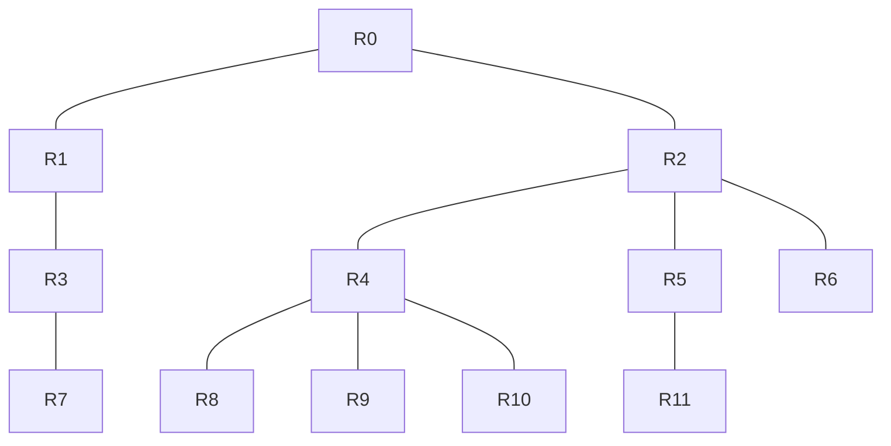

- **Interesting paths:** exactly **one** path between any two routers — no loops, no
  redundancy. RIP and EIGRP always agree. Useful as a *control* to confirm basic
  convergence before testing the harder topologies.
- **Computers:** **PC-A** → **R7** (gateway `192.168.1.1`); **PC-B** → **R11** (gateway `192.168.33.1`); **PC-C** → **R6** (gateway `192.168.65.1`); **PC-D** → **R8** (gateway `192.168.97.1`). Ping between PCs to test end-to-end reachability.
- **Failure test:** cut **R0–R2** (`10.0.1.0/30`) → the entire `R2` subtree becomes
  unreachable with **no reroute** (a tree has no backup paths).

## 02 · Linear chain

14 routers in a line; all links `100/10`.

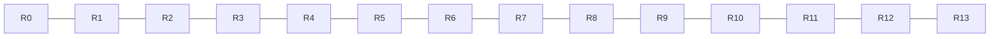

- **Interesting paths:** pure hop accumulation, single path. End-to-end is **13 hops** —
  still inside RIP's limit (compare with #07, which exceeds it).
- **Computers:** **PC-A** → **R0** (gateway `192.168.2.1`); **PC-B** → **R13** (gateway `192.168.34.1`); **PC-C** → **R4** (gateway `192.168.66.1`); **PC-D** → **R9** (gateway `192.168.98.1`). Ping between PCs to test end-to-end reachability.
- **Failure test:** cut a middle link, e.g. **R6–R7** (`10.0.6.0/30`) → the far half is
  isolated; RIP poisons the route, EIGRP marks it unreachable immediately.

## 03 · Interlocking loops  ⭐

Chain `R0…R11` (`100/10`) plus 10 *slow* chords (`10/100`) that create many overlapping
cycles.

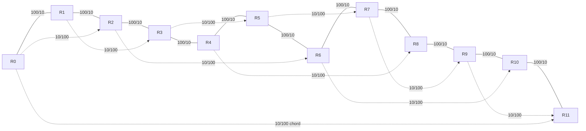

- **Interesting paths:** `R0` and `R11` are joined **directly** by the slow chord
  (`10.0.17.0/30`) *and* by the 11-hop fast chain.
  - **RIP** takes the **1-hop 10 Mbps chord** (fewest hops).
  - **EIGRP** takes the **11-hop 100 Mbps chain** (composite metric ≈ 210 vs 1100).
  Same reachability, opposite path — the clearest RIP-vs-EIGRP contrast in the set.
- **Computers:** **PC-A** → **R0** (gateway `192.168.3.1`); **PC-B** → **R11** (gateway `192.168.35.1`); **PC-C** → **R3** (gateway `192.168.67.1`); **PC-D** → **R8** (gateway `192.168.99.1`). Ping between PCs to test end-to-end reachability.
- **Failure test:** cut the chord **`10.0.17.0/30`** → RIP must reconverge onto a longer
  path; the many cycles exercise split-horizon / poison-reverse loop avoidance.

## 04 · Ring

16 routers in a ring; all links `100/10`.

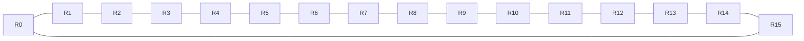

- **Interesting paths:** to the opposite node there are **two equal-cost directions**
  (clockwise / counter-clockwise), each 8 hops → both RIP and EIGRP load-balance (ECMP).
- **Computers:** **PC-A** → **R0** (gateway `192.168.4.1`); **PC-B** → **R8** (gateway `192.168.36.1`); **PC-C** → **R4** (gateway `192.168.68.1`); **PC-D** → **R12** (gateway `192.168.100.1`). Ping between PCs to test end-to-end reachability.
- **Failure test:** cut **R3–R4** (`10.0.3.0/30`) → the ring stays fully connected via the
  other direction; a great *survivable* reconvergence demo (no outage).

## 05 · Star / hub-and-spoke

One hub (`R0_hub`, 14 ports) with 14 spokes; all links `100/10`.

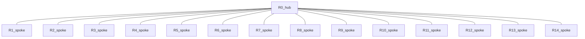

- **Interesting paths:** every spoke-to-spoke path is exactly **2 hops** through the hub;
  there are no alternates. The hub is a single point of failure.
- **Computers:** **PC-A** → **R1_spoke** (gateway `192.168.5.1`); **PC-B** → **R8_spoke** (gateway `192.168.37.1`); **PC-C** → **R4_spoke** (gateway `192.168.69.1`); **PC-D** → **R12_spoke** (gateway `192.168.101.1`). Ping between PCs to test end-to-end reachability.
- **Failure test:** cut any spoke link (e.g. `10.0.0.0/30`) → that spoke is isolated; all
  other spokes are unaffected.

## 06 · Full mesh

10 routers, every pair connected (45 links), all `1000/10`.

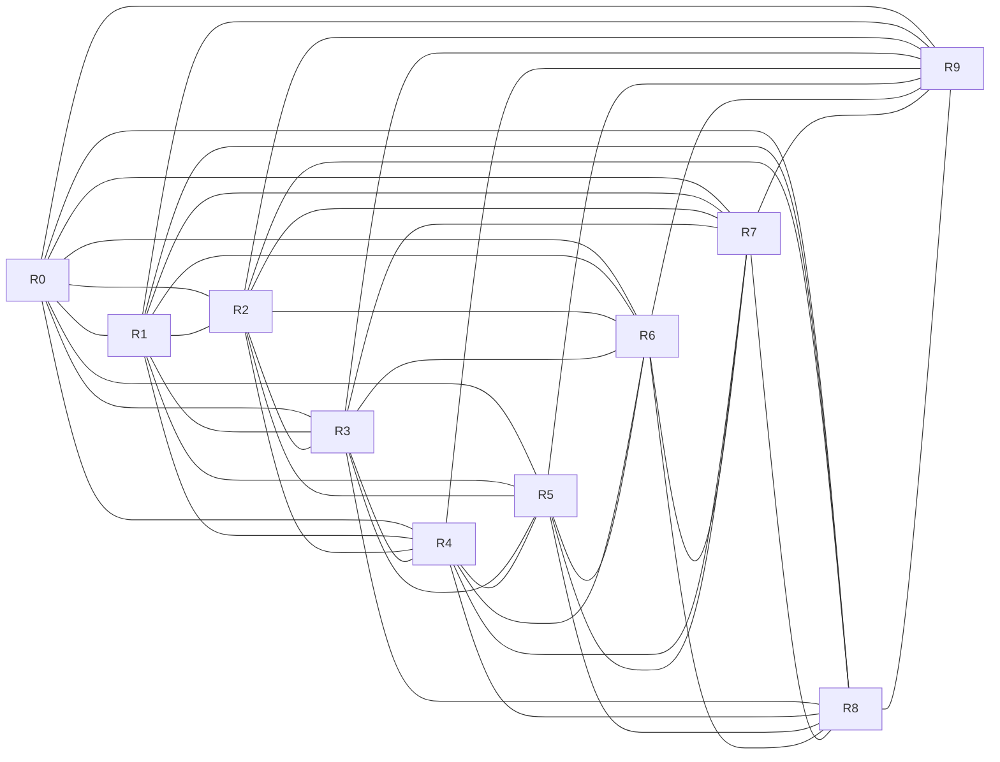

- **Interesting paths:** every pair is **1 hop** direct. EIGRP has 8 feasible successors for
  every destination.
- **Computers:** **PC-A** → **R0** (gateway `192.168.6.1`); **PC-B** → **R9** (gateway `192.168.38.1`); **PC-C** → **R3** (gateway `192.168.70.1`); **PC-D** → **R6** (gateway `192.168.102.1`). Ping between PCs to test end-to-end reachability.
- **Failure test:** cut the direct **R0–R9** link (`10.0.8.0/30`) → traffic instantly
  reroutes 2 hops via any third router (e.g. `R0→R1→R9`) with near-zero loss.

## 07 · Count-to-infinity chain  ⭐

20 routers in a line; all links `100/10`. End-to-end = **19 hops**.


- **Interesting paths:**
  - **RIP diameter limit:** `R0 → R15` (`10.0.14.2`) = 15 hops **works**; `R0 → R16`
    (`10.0.15.2`) = 16 hops is **unreachable** under RIP but fine under EIGRP.
  - **Count-to-infinity:** while pinging `R0 → R19`, cut **R9–R10** (`10.0.9.0/30`). With
    split-horizon disabled, watch RIP's metric climb slowly to 16; EIGRP declares
    unreachable almost immediately.
- **Computers:** **PC-A** → **R0** (gateway `192.168.7.1`); **PC-B** → **R19** (gateway `192.168.39.1`); **PC-C** → **R6** (gateway `192.168.71.1`); **PC-D** → **R13** (gateway `192.168.103.1`). Ping between PCs to test end-to-end reachability.
- **Failure test:** the R9–R10 cut above (no redundant path exists, so the demonstration is
  the *convergence time* difference, not survivability).

## 08 · Parallel redundant links  ⭐

10-router fast spine (`1000/10`) with parallel slow links and feasibility cross-links.

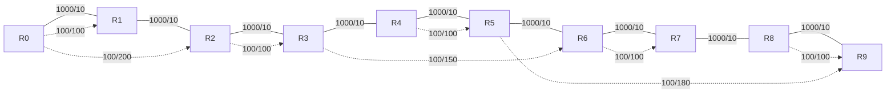

- **Interesting paths:** the spine is primary; the cross-links `R0–R2`, `R3–R6`, `R5–R9`
  are **feasible successors**. With `variance`, EIGRP can unequal-cost load-balance over the
  parallel `1000` + `100` links.
- **Computers:** **PC-A** → **R0** (gateway `192.168.8.1`); **PC-B** → **R9** (gateway `192.168.40.1`); **PC-C** → **R3** (gateway `192.168.72.1`); **PC-D** → **R6** (gateway `192.168.104.1`). Ping between PCs to test end-to-end reachability.
- **Failure test:** cut **R8–R9** (`10.0.8.0/30`) → EIGRP instantly uses the **R5–R9**
  cross-link (`10.0.16.0/30`) — near-zero loss; RIP drops traffic for several seconds.

## 09 · Hierarchical (core / distribution / access)

3 core (`C0–C2`, full mesh, `1000/10`), 6 distribution (`D0–D5`, each dual-homed to two
cores), 12 access (`A0–A11`, one per parent), plus `D0–D1 / D2–D3 / D4–D5` links (`100/10`).

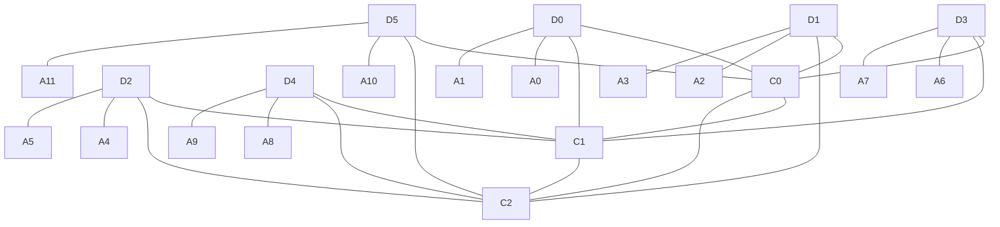

- **Interesting paths:** access-to-access always climbs to the core and back, but each
  distribution router is **dual-homed** to two cores → redundant paths and EIGRP feasible
  successors.
- **Computers:** **PC-A** → **A0** (gateway `192.168.9.1`); **PC-B** → **A11** (gateway `192.168.41.1`); **PC-C** → **A2** (gateway `192.168.73.1`); **PC-D** → **A9** (gateway `192.168.105.1`). Ping between PCs to test end-to-end reachability.
- **Failure test:** cut **D0–C0** (`10.0.3.0/30`) → D0 reroutes through its second uplink
  `C1` with no outage.

## 10 · Structured partial mesh

Ring of 24 (`R0…R23`) plus 18 chords, varied metrics.

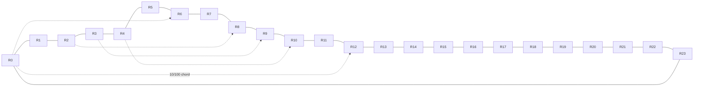
*(ring shown solid; a few representative chords dotted — see the file for all 18.)*

- **Interesting paths:** a scaled version of #03. `R0→R12` is **1 hop** over the slow
  `10/100` chord (`10.0.25.0/30`) but 12 hops around the ring — **RIP takes the chord,
  EIGRP weighs its poor bandwidth against the faster ring**. Many chords → many divergences.
- **Computers:** **PC-A** → **R0** (gateway `192.168.10.1`); **PC-B** → **R12** (gateway `192.168.42.1`); **PC-C** → **R6** (gateway `192.168.74.1`); **PC-D** → **R18** (gateway `192.168.106.1`). Ping between PCs to test end-to-end reachability.
- **Failure test:** cut a ring segment (e.g. `10.0.5.0/30`, R5–R6) → reroute via chords.

## 11–13 · Huge random meshes

Connected random graphs (random spanning tree + extra random edges), **random bandwidth**
`{10, 100, 1000, 10000}` Mbps and **random delay** `1–199`. Seeded, so they regenerate
identically.

| # | Routers | PCs | Router links | Independent loops | Avg degree |
|---|:------:|:---:|:-----------:|:-----------------:|:----------:|
| 11 | 100 | 4 | 249 | ~150 | 4.98 |
| 12 | 250 | 4 | 549 | ~300 | 4.39 |
| 13 | 400 | 4 | 799 | ~400 | 4.00 |

- **Interesting paths:** hundreds of independent cycles mean RIP (hop count) and EIGRP
  (composite) disagree constantly, and there are many alternates to reconverge onto after a
  failure. On the 250- and 400-node graphs the **network diameter can exceed 15 hops**, so
  some node pairs are **unreachable under RIP** while EIGRP still routes them — a good
  large-scale illustration of RIP's limit.
- **Computers:** low-degree routers selected far apart: **11:** PC-A/R42, PC-B/R89, PC-C/R24, PC-D/R55; **12:** PC-A/R181, PC-B/R239, PC-C/R77, PC-D/R151; **13:** PC-A/R305, PC-B/R327, PC-C/R95, PC-D/R379. Gateways use the `/24` subnets listed above.
- **Failure test:** traceroute the active path, cut one of its links, and watch the reroute
  among the many alternates (fast for EIGRP, slower for RIP).

---

## 14 · Enterprise WAN — dual MPLS + Internet backup  ⭐

**Naming:** letter = sub-network. **A** = HQ / data-center core, **B** = WAN transport,
**C** = branches / remote.
`A1` HQ core · `A2/A3` HQ WAN edges · `A4` data center · `B1/B2` MPLS PEs · `B3` Internet
gateway · `C1–C4,C6` branches · `C5` dual-homed branch · `C7` DR site.

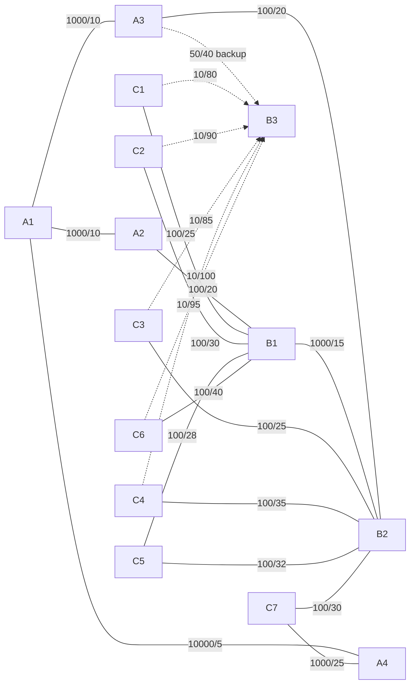

- **Interesting paths:** `C1 → A4` (data center) is **4 hops** via MPLS
  (`C1→B1→A2→A1→A4`) *and* **4 hops** via the Internet backup (`C1→B3→A3→A1→A4`). **RIP
  ties on hop count and may forward over the 10 Mbps backup; EIGRP stays on the 100 Mbps
  MPLS** and keeps the Internet path as a feasible-successor backup.
- **Computers:** **PC-A** → **C1** (gateway `192.168.14.1`); **PC-B** → **A4** (gateway `192.168.46.1`); **PC-C** → **C3** (gateway `192.168.78.1`); **PC-D** → **C7** (gateway `192.168.110.1`). Ping between PCs to test end-to-end reachability.
- **Failure test:** cut **C1–B1** (`10.0.7.0/30`) → traffic fails over to the Internet
  backup `C1→B3` (`10.0.8.0/30`). For a secondary-path check, inspect **C5**; cut **C5–B1**
  (`10.0.15.0/30`) → EIGRP uses the `B2` feasible successor instantly.

## 15 · Dual data center (active/active)  ⭐

**Naming:** **A** = DC1, **B** = DC2, **C** = WAN aggregation, **D** = branches,
**E** = Internet / campus edges.
`A1/A2` DC1 cores · `B1/B2` DC2 cores · `C1` WAN-east · `C2` WAN-west · `C3` WAN-central ·
`D1–D7` branches · `E1/E2` Internet · `E3/E4` campus.

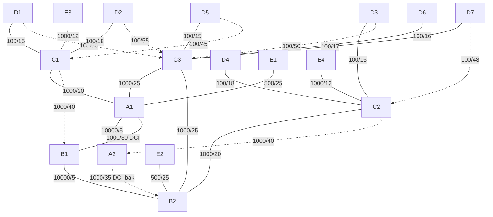

- **Interesting paths:**
  - `C3` (WAN-central) reaches **both** data centers at equal `1000/25` → EIGRP
    **equal-cost load balancing** across DC1 and DC2.
  - `D1 → DC2 edge E2`: **RIP** takes the fewest hops (via central `C3→B2`); **EIGRP**
    compares cumulative delay and may route through the East region + DCI
    (`D1→C1→A1→B1→B2`) — more hops, lower delay.
- **Computers:** **PC-A** → **D1** (gateway `192.168.15.1`); **PC-B** → **E2** (gateway `192.168.47.1`); **PC-C** → **D4** (gateway `192.168.79.1`); **PC-D** → **E4** (gateway `192.168.111.1`). Ping between PCs to test end-to-end reachability.
- **Failure test:** cut **D1–C1** (`10.0.10.0/30`) → D1 falls back to its `C3` backup
  (`10.0.11.0/30`). For ECMP, inspect the routing table on central branch **D6**.

## 16 · Regional ISP backbone  ⭐

**Naming:** **A** = core POPs, **B** = aggregation, **C** = customer edges,
**D** = transit / peering.
`A1–A6` core ring · `B1/B2` aggregation · `C1–C4` customers · `D1` transit · `D2` IX peer ·
`D3` CDN peer.

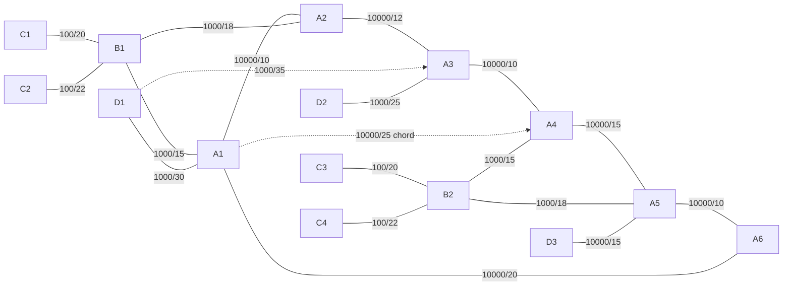

- **Interesting paths:**
  - `C1 → C3`: the **A1–A4 chord** yields a 5-hop path vs the 7-hop ring — a clean
    chord-vs-ring choice.
  - `C1 → CDN D3` (at A5): from A1 there are **two 2-hop directions** (via `A6`, or via
    the chord + `A4`). RIP can't tell them apart; EIGRP picks the lower-delay `A6`
    direction.
  - Transit `D1` is **dual-homed** to `A1`/`A3` → successor + feasible successor for the
    default route.
- **Computers:** **PC-A** → **C1** (gateway `192.168.16.1`); **PC-B** → **C3** (gateway `192.168.48.1`); **PC-C** → **C2** (gateway `192.168.80.1`); **PC-D** → **D3** (gateway `192.168.112.1`). Ping between PCs to test end-to-end reachability.
- **Failure test:** cut **A1–D1** (`10.0.15.0/30`) → EIGRP switches the default route to the
  `A3` feasible successor with no recomputation.

---

## Quick reference — recommended experiments

| Goal | Topology | Hosts / routers | Action |
|------|----------|------------|--------|
| RIP vs EIGRP pick different paths | 03 | PC-A ↔ PC-B (R0 ↔ R11) | ping hosts; traceroute between routers |
| RIP 15-hop limit | 07 | PC-A ↔ PC-B (R0 ↔ R19) | traceroute R0 → R16 to see RIP limit |
| Count-to-infinity | 07 | PC-A ↔ PC-B (R0 ↔ R19) | ping, cut `10.0.9.0/30` |
| Feasible-successor failover | 08 | PC-A ↔ PC-B (R0 ↔ R9) | ping, cut `10.0.8.0/30` |
| Survivable ring reroute | 04 | PC-A ↔ PC-B (R0 ↔ R8) | ping, cut `10.0.3.0/30` |
| Backup-link failover | 14 | PC-A ↔ PC-B (C1 ↔ A4) | ping, cut `10.0.7.0/30` |
| Equal-cost load balancing | 15 | D6 → both DCs | inspect EIGRP table |
| Chord vs ring | 16 | PC-A ↔ PC-B (C1 ↔ C3) | ping hosts; traceroute between routers |

*Each topology file is ready to load with its two PCs and LANs already attached. Router/link counts in the index describe the routing network; PC links are additional.*
